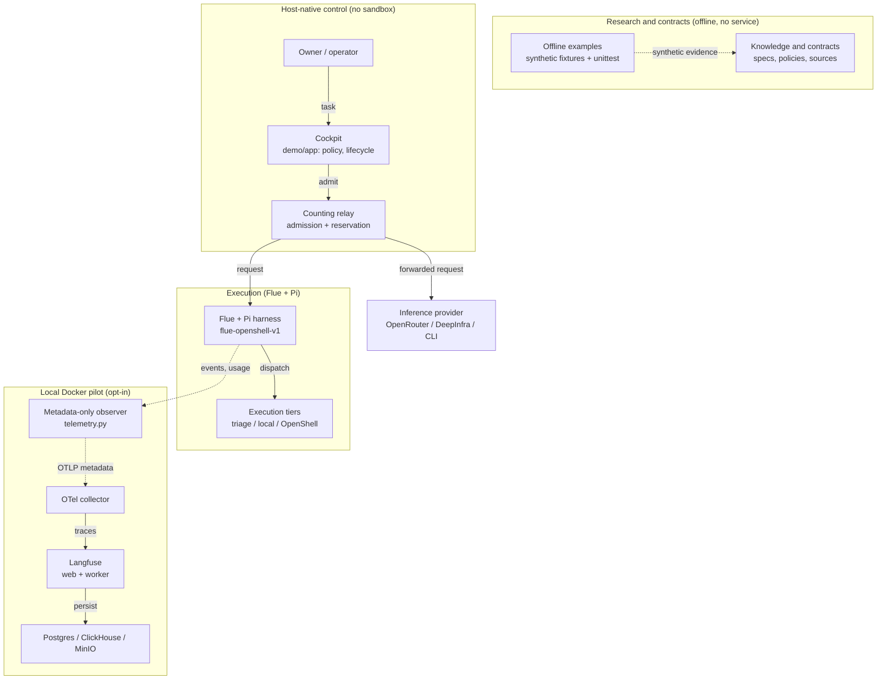

# High-level architecture

One page for the repository: what it measures, where the demo runs, and what stays offline.
The editable Archify source is [aeion-observability-high-level.architecture.json](aeion-observability-high-level.architecture.json);
`archify render architecture` regenerates the HTML next to it.

## Reading it

| Layer | Where | What it owns |
| --- | --- | --- |
| Research | `knowledge/` | The framework, telemetry contract, control loop, quality rules and source register. It states requirements; it does not run. |
| Offline evidence | `examples/`, `tests/` | Synthetic fixtures and their arithmetic. Python standard library only; no key, no service. |
| Control | `demo/app` | Task contract, profiles, policy eligibility, lifecycle, scoring, and the counting relay that admits requests inside the 300k budget. It runs on the host, not in a container. |
| Execution | `demo/flue`, `demo/openshell` | Flue + Pi in three tiers: in-memory triage, folder-confined local assistant, autonomous coding whose tools run only in NVIDIA OpenShell. |
| Telemetry | `demo/compose.yaml`, `demo/otel-collector.yaml` | OTLP collector into Langfuse, with ClickHouse/Postgres/MinIO storage. The observer sends metadata and usage, not raw prompts. |
| Memory | `demo/claude-mem`, Hindsight services | Durable recall for the pilot; local state, not part of the published contracts. |

## What the diagram deliberately omits

- The five frozen synthetic task contracts, the 250k checkpoint and the handover flow: see
  [the demo runbook](../../demo/README.md) and [the component spec](../../knowledge/components/docker-demo.md).
- OPS and CROA: named in the framework, not implemented here. The diagram shows no boundary it
  does not have.
- Cost and quality numbers: they live in [the validation record](../../work/validation.md), with
  their synthetic labels.
