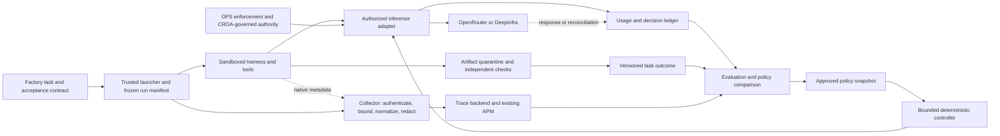

# Agent-session observability and optimization

All requirements below are proposed Æion requirements. The source register distinguishes
documented upstream functionality from research results. This specification is not a deployed
controller, a sandbox, a benchmark result or a CROA conformance assessment.

## Intent

Answer five questions for each task:

1. What ran: harness, task, model, provider, parameters, tools, sandbox and source revision?
2. What happened: attempts, waits, errors, decisions, usage and delivered artifacts?
3. Did it satisfy the task's acceptance contract without corrective human work?
4. Which resource/behavior actually limited it, and how certain is that diagnosis?
5. Which **already authorized** execution profile should run the next task/request/checkpoint?

### Fit with the Æion projects

| Project | Responsibility | Relationship to this framework |
| --- | --- | --- |
| Factory | Development instructions, code/spec links, checks and review | Supplies task contracts and validation evidence; consumes recommendations |
| Agentic OPS | Proposed isolation, credential mediation, resource and lifecycle controls | Must qualify and enforce execution constraints; supplies trusted boundary events |
| Æion CROA | Implemented evidence-packet audit kit based on the CROA specification | Can assess relevant governance evidence; does not enforce a running session |
| Observability | Measurement contracts, accounting, outcome evaluation and optimization policy | Joins evidence and chooses within the allowed profile set |

Factory and CROA already have local implementations. The sibling OPS project is a proposal.
Do not assume its trusted supervisor or controls exist merely because this diagram names them.
Until the actuation boundary is implemented and qualified, run observe/shadow modes only.

### Smallest useful architecture



These are logical responsibilities, not a requirement for nine services. A local pilot can use
one launcher process, one Collector, an existing backend and a small local outcome/usage store.
Use a protected local database for authoritative accounting if needed; a JSONL export is an
interchange artifact, not an atomic concurrent budget implementation.

Keep the controller's decision path independent of dashboard queries. It reads a bounded
health snapshot and immutable policy locally. Backend ingestion delay must not turn into an
unbounded request wait or an implicit switch to an unauthorized endpoint.

### Build versus reuse

Reuse OTel transport, a trace/evaluation backend, native harness telemetry and provider routing.
Æion adds the task/outcome contract, provenance-aware joins, approved profile selection and
qualification scenarios. Do not initially build a trace database, universal model gateway,
new agent orchestrator, streaming protocol translator or reinforcement-learning service.

Langfuse core is the first backend candidate because it connects traces, scores, datasets and
experiments. Its self-hosted stack has meaningful operational weight. Reuse an existing APM or
evaluate OpenLIT/MLflow if that weight does not fit the pilot. The selection is conditional,
not an installed dependency. See the [comparison](../references/state-of-the-art.md).

## Data sources

| Source | Evidence | Trust and limitations |
| --- | --- | --- |
| Operator/Factory task contract | Scope, allowed work, acceptance checks, deadline and cohort | Frozen before assignment; repo text cannot authorize new destinations |
| Launcher/OPS supervisor | Effective versions, resources, lifecycle, capability decisions | Trusted only after deployment qualification |
| Native harness telemetry | Interactions, LLM/tool spans, attempts, compactions and usage | Workload-origin; may omit, mislabel or be forged |
| Inference adapter | Canonical request metadata, reservations and response IDs | Trusted mediation point only if workload cannot bypass it |
| Provider/router | Returned model, usage, cost, endpoint and errors | Provider-reported; some fields absent or estimated; reconcile separately |
| CI/evaluator | Checks against an immutable artifact, rubric and evidence | Evaluator independence and test integrity must be established |
| Human outcome channel | Corrections, acceptance, repair minutes, delayed regressions | Explicit coverage; missing feedback is not success |
| Research/catalog snapshots | Capabilities, protocol limits, prices and known caveats | Advertised support is not execution proof; freshness recorded |

## Inputs

### Task contract and run manifest

The proposed [manifest example](../../examples/run-manifest.json) records:

- Stable task identity and scope; unique run and harness-session IDs; parent relationships.
- Task family/risk/data class and pre-registered cohort; source/artifact/spec/check versions.
- Runtime/harness/adapter versions; effective OPS policy digest and controller-policy digest.
- Authentication mode and opaque credential reference; no secret value or local token file.
- Allowed routes/profiles, API protocol, privacy/location requirements and fallback rules.
- Task deadline, bounded attempts/turns/concurrency, budget basis and exposure limits.
- Content/sampling policy, telemetry producers and required accounting/outcome completeness.
- Acceptance stage: for example, a verified patch ready for Factory review, not an automatic deploy.

Missing required enforcement inputs refuse automated actuation. For an observe-only integration,
record unavailable fields explicitly and prevent unsupported optimization claims.

### Approved execution profile

An arm is a versioned tuple, not just a model name:

```text
(harness + version, API protocol, auth mode, model revision,
 router, serving-provider constraints, inference parameter bundle,
 context/tool-state strategy, retry policy, privacy class, resource profile)
```

Changing the model, effort, service tier, provider, context strategy or resource envelope changes
the experiment treatment. Avoid a combinatorial grid: begin with a few coherent bundles and
compare them on the actual task family. Profiles requiring unsupported fields are ineligible.

## Outputs

| Output | Required meaning |
| --- | --- |
| Correlated timeline | What is observed, by whom, for which interaction/attempt and time boundary |
| Usage ledger | Versioned charge observations, units, lineage, completeness and reconciliation |
| Outcome record | Acceptance, intervention, safety and delayed-regression status for a bound artifact |
| Decision record | Candidates, exclusions, selected profile, policy/feature snapshot and propensity |
| Task report | Cost/time/autonomy vector plus evidence coverage and uncertainty |
| Policy candidate | Reproducible change, evaluation comparison, applicability and rollback target |
| Operational alerts | Actionable outage, exhaustion, telemetry-loss or quality-regression signals |

A Factory integration should read a task report/policy recommendation as untrusted advisory
input, verify its version/scope/freshness, and apply only a policy already accepted by the owner.
The design requires no global skill installation or implicit change to sibling repositories.

## Invariants

| ID | Requirement | Decisive qualification scenario |
| --- | --- | --- |
| OBS-01 | Optimization never enlarges authority | A cheaper route outside the allowlist remains rejected |
| OBS-02 | One cohort, explicit denominators | Failed, rejected, timed-out and unresolved tasks remain visible |
| OBS-03 | Acceptance is bound to actual artifacts | A test result for a different digest cannot certify this output |
| OBS-04 | Missing signals remain unknown | Lost final usage and absent human coverage cannot become zero/success |
| OBS-05 | Native token semantics survive normalization | Anthropic and OpenAI-style cache fixtures produce correct totals |
| OBS-06 | Billable attempts count once each | Duplicate exports deduplicate; a distinct paid retry still counts |
| OBS-07 | Cost bases remain distinct | Subscription allocation cannot be presented as provider invoice cost |
| OBS-08 | Requested and observed facts differ | Requested temperature/provider cannot fill unknown effective fields |
| OBS-09 | Decision and actuation are recorded | No adapter change without policy ID and applied/failed acknowledgement |
| OBS-10 | Switching occurs at a qualified boundary | Pending tool calls or incompatible state prevent model switching |
| OBS-11 | Budgets are enforced outside the agent | Concurrent reservations cannot exceed admitted exposure |
| OBS-12 | Telemetry has bounded content/cardinality | Secret canaries and arbitrary task labels do not reach metric labels |
| OBS-13 | Accounting/outcomes outlive trace sampling | Sampled-out traces retain task and usage denominators |
| OBS-14 | Workload cannot impersonate trusted evidence | Forged supervisor identity is rejected or relabeled untrusted |
| OBS-15 | Quality learning waits for valid labels | Pending/censored tasks are not trained as successful or failed labels |
| OBS-16 | Promotion has statistical and operational gates | Unsupported or low-evidence profiles stay in shadow |
| OBS-17 | Changes have rollback and drift detection | Regressions stop the canary and restore a compatible approved profile |
| OBS-18 | Required approvals retain their meaning | Reduced prompt count cannot disable review, sandbox or CROA policy |

## Determinism

Eligibility, budget reservation, outcome aggregation and policy application use deterministic
code, explicit versions, decimal money and stable ordering. Record any randomization algorithm,
seed and assignment probability; the same frozen inputs should reproduce the routing decision.

Model output, external service behavior and human judgments are not deterministic. A seed or
temperature of zero does not establish end-to-end reproducibility. Reproduction means replaying
the decision/check evidence against named versions, and reporting unavailable provider internals.

Keep the task outcome vector separate from any learned scalar reward. Online classifiers or
LLM analysts can propose profiles or failure clusters; they cannot edit enforcement policy,
promote themselves, certify task success or replace a trusted admission check.

## Acceptance checks

The [implementation plan](../operations/implementation-plan.md) specifies staged gates and
qualification cases. A release must demonstrate, rather than merely document:

- End-to-end correlation across launcher, harness, tool, provider and outcome channels.
- Complete cost lineage under retry, duplicate delivery, interrupted streams and reconciliation.
- Honest autonomy measurement under human repair, silence, cancellation and delayed failure.
- Safe profile application, unsupported-control rejection, deadline cancellation and rollback.
- Content minimization, untrusted-event separation and resilience to collector/backend failure.
- A canary comparison on representative tasks with a fixed control and declared uncertainty.

Document/JSON checks performed for this proposal verify internal consistency only. Provider
qualification and workload gains remain unmeasured.

## Out of scope

- Replacing Factory or implementing CROA enforcement in a telemetry dashboard.
- Claiming perfect autonomy, security, universal CLI compatibility or guaranteed savings.
- Inferring hidden chain-of-thought, provider queue time, GPU utilization or internal retries.
- Training a router from unlabelled traces or silently experimenting on high-impact actions.
- Altering authentication eligibility, account sharing, governance requirements or production access.
- Deploying a multi-tenant hosted platform, Kubernetes stack or new gateway for the research phase.
